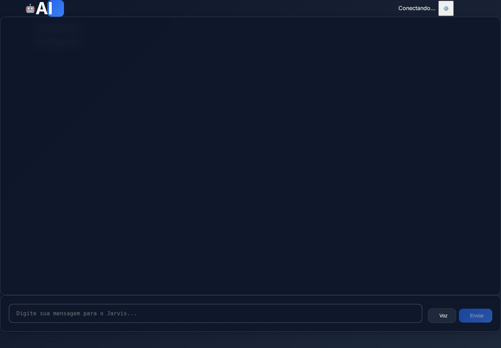

# Jarvis

Projeto de assistente pessoal de Samuel Felipe Assis Nunes, reunindo o aplicativo mobile e o backend Python com interface web.

## Interface web



Captura do estado atual da interface web, ainda em desenvolvimento, sem conexão com o backend, o MySQL ou o Ollama. Há inconsistências entre o HTML, os estilos e o JavaScript; a imagem não representa uma conversa funcional.

## Estrutura

| Pasta | Conteúdo |
| --- | --- |
| [jarvis-app](jarvis-app/) | Aplicativo React Native com Expo e TypeScript |
| [project_Jarvis](project_Jarvis/) | Backend FastAPI, CLI, integrações e testes |
| [project_Jarvis/web](project_Jarvis/web/) | Interface web servida pela API |

## Aplicativo mobile

Requisitos: Node.js e npm.

```sh
cd jarvis-app
npm ci
npm start
```

Consulte também o [README do aplicativo](jarvis-app/README.md). A presença dos dois componentes neste repositório não significa que a integração mobile com todos os endpoints do backend esteja concluída.

## Backend e interface web

Requisitos: Python 3.12, MySQL e Ollama.

No PowerShell:

```powershell
cd project_Jarvis
python -m venv .venv
.\.venv\Scripts\python.exe -m pip install -r requirements.txt
Copy-Item .env.example .env
```

Preencha o `.env` com a configuração local e prepare os modelos do Ollama indicados em `config/default_config.yaml`. Depois, com o MySQL e o Ollama em execução:

```powershell
.\.venv\Scripts\python.exe api.py
```

Acesse <http://127.0.0.1:8000> para a interface web e <http://127.0.0.1:8000/docs> para a documentação da API.

O [README do backend](project_Jarvis/README.md) descreve funcionalidades, limitações, configuração dos modelos e testes. Há módulos experimentais e arquivos ainda sem implementação.

## Arquivos locais

Dependências instaladas, ambientes virtuais, credenciais, bancos de dados, conversas, uploads e caches ficam fora do versionamento. O `.env.example` contém apenas os nomes das configurações, sem credenciais.

## Autor

[Samuel Felipe Assis Nunes](https://github.com/samuelfelipeassisnunes07-ux)
